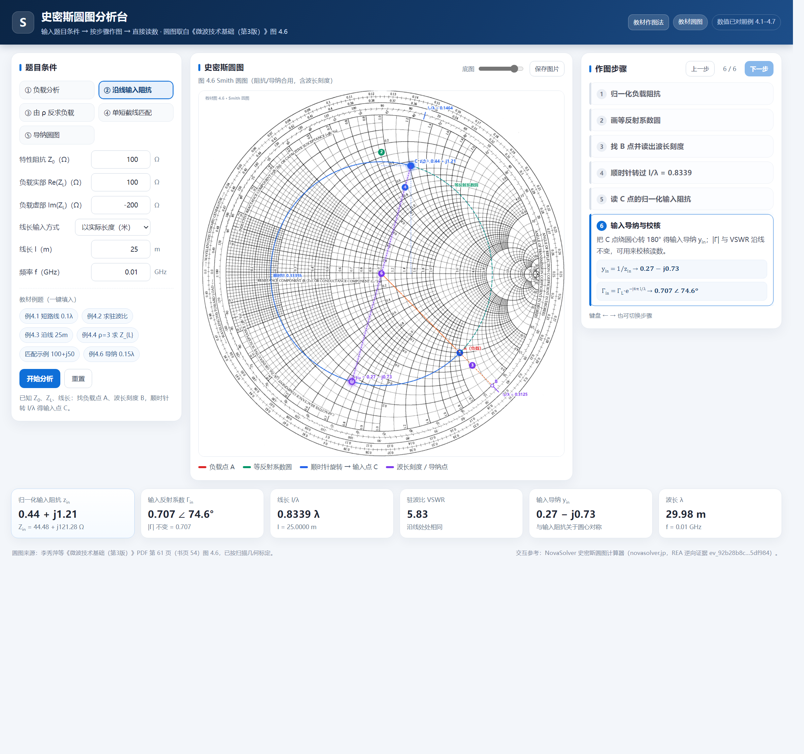

# 史密斯圆图分析台（教材圆图版）

把《微波技术基础（第3版）》（李秀萍、刘凯明、高泽华）第 54 页图 4.6 的 Smith 圆图做成可交互的分析工具：
**输入题目条件 → 按教材方法逐步骤作图 → 直接读数**。底图就是教材扫描圆图本身，所有公式、作图顺序、方向约定都按书中 4.1–4.3 节（书页 54–70）整理。



## 快速开始

- 双击 `启动史密斯圆图分析.cmd`（用 Edge 应用模式打开；没有 Edge 就用默认浏览器）。
- 或者直接双击 `index.html`。纯前端、离线可用，不需要安装任何东西、不需要本地服务器。
- 点右上角 **教材作图法**，可查看按课本整理的完整作图方法（含公式编号与例题）。
- 键盘 `←` / `→` 切换作图步骤；`Esc` 关闭教程弹窗。

## 八种分析模式

| 模式 | 输入 | 输出 / 作图 | 教材依据 |
|---|---|---|---|
| ① 负载分析 | Z₀、Z_L、f | z_L、Γ、\|Γ\|、∠Γ、VSWR、行波系数、回波损耗、失配损耗、λ、导纳点 | 4.1.2 表 4.3；4.1.3-1 图 4.7、式 (4.21)(4.26)(4.27) |
| ② 输入阻抗（沿线） | Z₀、Z_L、线长（λ 或米）、**旋转方向（向电源/向负载）**、f | 归一化 A → 等反射系数圆 → B 点波长刻度 → **按方向转 l/λ（2βl=4πl/λ）** → C 点读数 → Z_in、y_in | 4.1.3-2；课件第 2 页口诀、第 12 页例题 |
| ③ 负载阻抗（由 ρ、d_min） | Z₀、**ρ 或 V_max/V_min**、d_min（λ 或米）、**λ 来源（f 或相邻最小值间距 Δ）** | 找 E（V_min）→ 以 O 为心、OE 为半径作圆 → 向负载转 d_min/λ 得 F → OF 与圆交 G → 读 z_L → 反归一 | 例 4.4；课件第 6–12、42–44 页 |
| ④ 并联单支节匹配 | Z₀、Z_L、f、支节类型（短路/开路）、选用解 | 课件 (a)–(g)：z_L → 等反射系数圆 → 对称点 y_L → 向电源转到单位电导圆 g=1（B₁/B₂）→ θ、d → 看单位外圆求 l → 校核；提示导纳三对调 | 4.3.1；课件第 27–41 页 |
| ⑤ 导纳计算（转 180°） | Z₀、Z_L、线长、f | 转 180° 得 y_L → 顺时针转 l/λ → y_in、Y_in、Z_in；提示导纳三对调 | 4.1.4 表 4.4、例 4.6；课件第 27 页 |
| ⑥ 输入导纳反推 Z_L | Z₀、Y_in（S）、线长 l/λ 或 m、f | 归一化 y_in → 点 P_in → 等反射系数圆 → 向负载（逆时针）转 l/λ → Γ_L → z_L、Z_L、y_L → 校核 | 课件基本功能反向；练习 4.1.2 |
| ⑦ 求 l/λ（由 y_L、y_in） | y_L（g_L,b_L）、目标类型（完整 y_in 或 Re(y_in)=1） | 由 y_L 定 L 点 → 等反射系数圆 → 向电源转到目标点 → l/λ=θ/720°；g=1 时给出 b_in 与两组解 | 练习 4.1.4–4.1.6 |
| ⑧ 圆图详解 | 无输入（纯讲解） | 逐类标注：Γ 平面与单位圆、实轴（纯电阻；左波节读 K、右波腹读 ρ）、±j 半区、等 r/等 x 圆簇、驻波比圆、波长/相角刻度、导纳读法；图下方给出图外图例 | 4.1.2、4.1.4、书页 54–62 |

每一步都给出：公式、代入值、结果，以及圆图上对应的作图元素（点、等反射系数圆、旋转弧、波长刻度、支节长度弧）。

例题可一键填入：教材例 4.1/4.2/4.3/4.4/4.6、**课件例题**（25+j25·0.2λ、ρ=3·Δ=20cm、V_max/V_min·d_min=0.15λ、25+j75 匹配、75+j40 匹配），以及 **4.1.1–4.1.6 六道圆图基本练习**。

### 4.1 圆图基本练习（4.1.1–4.1.6）

| 题号 | 使用的模式 | 已知条件 | 工具结果 |
|---|---|---|---|
| 4.1.1 | ② 输入阻抗 | Z_L=80−j60Ω，Z₀=100Ω，l/λ=0.2 | Z_in≈59.14+j35.89Ω，Y_in≈0.01236−j0.00750S |
| 4.1.2 | ⑥ 输入导纳反推 | Y_in=(2.5−j1.5)/100S，Z₀=50Ω，l/λ=0.15 | Z_L≈29.73−j18.24Ω |
| 4.1.3 | ② 输入阻抗 | Z_L=80−j20Ω，Z₀=50Ω，距负载 0.35λ | Γ(0.35λ)=0.274∠83.1°，VSWR=1.755 |
| 4.1.4 | ⑦ 求 l/λ | y_L=0，目标 y_in=−j0.3 | l/λ≈0.4536 |
| 4.1.5 | ⑦ 求 l/λ（g=1） | z_L=0.5−j0.1（y_L=1.923+j0.385），目标 Re(y_in)=1 | 取 y_in=1−j0.721 时 l/λ≈0.1185；另一解 l/λ≈0.4235（b_in=+j0.721） |
| 4.1.6 | ⑦ 求 l/λ | 终端开路 y_L=0，目标 y_in=−j0.2 | l/λ≈0.4686 |
| 4.3 | ② 输入阻抗 | Z_L=70−j20Ω，Z₀=50Ω，线长 0.6λ | VSWR≈1.606；Γ_L≈0.232∠−35.5°；Y_L≈0.0132+j0.0038S；Z_in≈39.61−j18.56Ω；d_min≈0.2006λ；d_max≈0.4506λ |

对应预设按钮已命名为 4.1.1–4.1.6 与 **4.3 综合题**，点一下即可复现上面的圆图与步骤。4.3 预设会把负载反射系数、负载导纳、首个 V_min/V_max 距离一并显示在结果卡里。

## 教材作图法（内置教程）

点右上角「教材作图法」打开，内容按书本整理：

1. **圆图坐标与刻度**（书页 54–55）：Γ=(Z_L−Z₀)/(Z_L+Z₀)，等 r 圆圆心 r/(1+r)、半径 1/(1+r)；等 x 圆圆心 (1,1/x)、半径 1/\|x\|；表 4.3 三个特殊点；外圈朝源波长刻度 0–0.5λ。
2. **标准六步作图法**（4.1.3-2，图 4.9/4.13，例 4.3）：归一化 → 等反射系数圆 → B 点读 l_B/λ → 顺时针转 l/λ → C 点读 r、x → 反归一化（转 180° 得 y_in）。
3. **读驻波比与行波系数**（4.1.3-1，图 4.7，式 4.21–4.29）：正实轴交点读 ρ，负实轴交点读 1/ρ。
4. **由 ρ 和 d_min 反求 Z_L**（例 4.4 解法 3，图 4.16）：E → H → 逆时针转 → F → G 点读数。
5. **导纳圆图**（4.1.4，表 4.4，例 4.6）：导纳圆图 = 阻抗圆图转 180°；先转 180° 读 y_L，再顺时针转 l/λ。
6. **并联单支节匹配**（4.3.1，图 4.29/4.30，例 4.7）：匹配圆 g=1，两解 B₁/B₂，支节长度从 P_sc/P_oc 起转。

教程中所有公式编号（式 4.20、4.21、4.26、4.30、4.61、4.63、4.86–4.100、4.101 等）与图号均与教材一致。

## 对照课件（微波工程基础 6）的审查结论

按 D:\2026 微波工程基础-6-齐紫航.pptx（48 页）逐页核对：

| 课件位置 | 课件要点 | 工具对应 | 处理 |
|---|---|---|---|
| 第 2 页 | Smith 圆图口诀：同心圆、纯阻线、左小右大、短路/匹配/开路、电抗圆、上下 ±j、等反射系数圆、驻波比读纯阻线右交点、**顺向源/逆向负载**、结果都在图里 | 圆图详解、②的旋转方向 | ②新增方向选择，步骤中写“顺向源、逆向负载” |
| 第 4 页 | 四个基本功能：求导纳、求 Γ/ρ、求输入阻抗、求负载阻抗 | ①、②、③、⑤ | 模式名改为课件术语（输入阻抗/负载阻抗/导纳计算） |
| 第 6–12、42–44 页 | 已知 SWR、d_min 求 Z_L：E 点→OE 为半径作圆→向负载转 d_min/λ→F→OF 交 G→读 z_L→反归一；V_max/V_min 也可给 | ③ | 输入新增“已知量 ρ 或 V_max/V_min”“λ 来源 f 或 Δ=相邻最小值间距”；步骤改为课件 E/F/G 六步 |
| 第 27 页 | 导纳图解法三对调：短路↔开路、V_max↔V_min、上下半区性质对调 | ④、⑤ | ④(c) 与⑤提示中写明 |
| 第 29–41 页 | 匹配 (a) 归一化 → (b) 等反射系数圆 → (c) 对称点 y_L → (d) 向电源转到单位电导圆 g=1 两交点 → (e) 读导纳、求 d=θ/4π·λ（±nλ/2）→ 看单位外圆求 l（两组解取短） | ④ | 步骤重排为 (a)–(g) 七步，加入 θ、d 公式、两组解与“取短”提示 |
| 第 39–41 页 | 例 1：Z₀=50、Z_L=25+j75；y_L=0.2−j0.6（0.412）；两解 d=0.280/0.396λ、支节取短 | ④ | 一键填入“课件例1 25+j75 匹配”，算得 d=0.2800λ（另一解 0.3962λ） |

仍建议后续补：双支节匹配（课件下次课内容）、串联单支节、50Ω 未知负载那题的完整参数、频率响应/带宽扫描。

## 圆图详解（新增）

点顶部「圆图详解」或左侧模式 ⑥，可逐层查看教材圆图每个曲线/直线的含义（共 9 步）：

1. **坐标系与三个特殊点**：明确标注**左短**（P<sub>sc</sub>：Γ=−1，z=0，K=0）、**中匹配**（圆心 Γ=0：z=1，ρ=1）、**右开**（P<sub>oc</sub>：Γ=+1，z=∞，ρ→∞）；同时给出 |Γ|=1 全反射边界。
2. **水平主轴**：x=0 的纯电阻线，r 向右增大。
3. **主轴刻度（K / ρ）**：左半轴（圆心→P<sub>sc</sub>，**左端短路**）为**电压波节点** V<sub>min</sub>，轴上读**行波系数 K**（1→0）；右半轴（圆心→P<sub>oc</sub>，**右端开路**）为**电压波腹点** V<sub>max</sub>，轴上读**驻波比 ρ**（1→∞）；**圆心**标注匹配点（K=ρ=1）。轴上直接画出 K=0.8/0.5/0.33/0.2/0 与 ρ=1.5/2/3/5/10/∞ 的刻度。
4. **上下半平面**：上半 +jX（感性）、下半 −jX（容性）；并按图上双标注说明导纳读法下对应 +jB / −jB。
5. **等 r 圆簇（电阻圆）**：圆心 r/(1+r)、半径 1/(1+r)，描出并标注 r = 0/0.25/0.5/0.75/1/2（与课本插图一致，印刷圆越靠右越密）。
6. **等 x 圆簇（电抗圆）**：圆心 (1,1/x)、半径 1/|x|，描出并标注 ±0.5/±1/±2/±4（其余值见圆图印刷标尺），上半 +x（感性）、下半 −x（容性）。
7. **单位圆 / 驻波比 / 圆外刻度**：示例 |Γ|=0.5 → ρ=3；外圈朝源/朝载方向与反射系数相角刻度。
8. **外圈电长度刻度**：一整圈 = **0.5λ = 1/2 波长**，从 0 起顺时针标 0 → 0.1λ → 0.2λ → 0.3λ → 0.4λ → 0.5λ。
9. **导纳读法**：同一点转 180° 读 y=1/z（r↔g，x↔b）。

圆图下方是**图外图例**，用文字概括每一族曲线/刻度的含义和取值范围（等 r、等 x、|Γ| 圆、驻波比圆、波长刻度、相角刻度、径向标尺、导纳读法），对应你说的“曲线簇在图外概括标注其值”。

## 字体与数学排版

- 全部下标改为真正的数学下标：Z<sub>L</sub>、Z<sub>0</sub>、z<sub>in</sub>、y<sub>L</sub>、d<sub>min</sub>、V<sub>min</sub>、P<sub>sc</sub> 等（HTML 用 `<sub>`，圆图叠加文字用 canvas 富文本渲染，下标自动缩小并下移）。
- 公式区使用数学衬线字体栈（Cambria Math / Times New Roman），正文用中文 UI 字体并加大字号与行高，结果卡片使用等宽数字。
- 圆图上的标签同样支持上下标，避免 "z_L" 这类写法。

## 圆图来源与标定

- 圆图取自 PDF 第 61 页（书页 54）的整页扫描图 图 4.6 Smith 圆图（阻抗/导纳合用，含波长刻度）。
- 原扫描页 4265×6162；脚本裁剪出单位圆区域并做灰度归一化，输出 `assets/smith-chart.png`（2000×2000）。
- 几何标定：用印刷的等 r / 等 x 圆做图像配准，得到扫描图中圆心 `(1000.125, 1000.125)`、半径 `rx=857.955 / ry=865.909` 像素（见 `assets/calibration.json`），程序按此映射 `Γ = u + jv` 到像素坐标，叠加线与印刷网格的偏差约 0.3% 半径。
- 波长刻度读数由程序按 `l/λ = (π − ∠Γ)/(4π)` 计算，不依赖肉眼估读；作图方向严格按教材（顺时针朝源、逆时针朝载）。

## 数值校核

`test/verify.mjs` 用 Node 跑 **35 项断言**，全部通过（含书中例题）：

- 例 4.1：Z₀=50Ω、终端短路、l=0.1λ → Z_in ≈ j36.4Ω（书 j36.4Ω）
- 例 4.2：Z₀=50Ω、Z_L=85+j30Ω → z=1.7+j0.6，ρ=2.00
- 例 4.3：Z₀=100Ω、Z_L=100−j200Ω、l=25m、f=10MHz → l/λ=0.8339，z_in=0.44+j1.21，Z_in≈45+j121Ω（书 45+j120Ω）
- 例 4.4：ρ=3、d_min=0.05m、λ=0.4m → Γ_L=0.5∠−90°，Z_L=30−j40Ω
- 例 4.6：Z₀=50Ω、Z_L=100+j50Ω、l=0.15λ → y_L=0.4−j0.2，y_in≈0.61+j0.66，Y_in≈0.0122+j0.0132 S
- 例 4.7：Z₀=100Ω、Z_L=75+j200Ω → d/λ≈0.26，y₁′≈1+j2.36，短路支节 l/λ≈0.06
- 单短截线：两个解均满足 Re(y)=1、加支节后 y=1（残差 <1e-9）

运行：`node test/verify.mjs`（任意 Node 22+ 均可；不依赖浏览器）。

## 逆向分析记录（NovaSolver 网站）

- 目标：https://novasolver.jp/zh/tools/smith-chart.html
- 运行时：REA 浏览器场景捕获（Edge headless），证据 ID `ev_92b28b8c3dc4761bd0e2bdbb093c10152d6cb34e6587afc1e0ed7305885df984`；页面无 console 错误、无网络请求（纯静态页 + 内联 JS）。
- 静态：4 组滑杆/数字输入、4 项结果（归一化 z、Γ 极坐标、VSWR、自由空间波长 λ=c/f）；canvas 手绘 Γ 平面（红色定电阻圆、蓝色定电抗圆、绿色虚线 \|Γ\| 圆、黄色当前 Γ 点）。
- 站方公式与教材一致：Γ=(Z_L−Z₀)/(Z_L+Z₀)，VSWR=(1+\|Γ\|)/(1−\|Γ\|)，定电阻圆 (r/(1+r),0) 半径 1/(1+r)，定电抗圆 (1,1/x) 半径 1/\|x\|；频率只影响 λ。
- 本站增强：教材扫描圆图底图、五种“按步骤作图”流程（含教材 4.1.4 导纳圆图与 4.3.1 支节匹配）、教材例题一键填入、教材作图法教程。

## 目录结构

```
smith-chart-lab/
├─ index.html                 界面
├─ css/style.css              样式（含数学排版与教程弹窗）
├─ js/smith.js                圆图数学（经典脚本，挂 window.Smith）
├─ js/app.js                  表单、步骤编排、canvas 叠加绘制、教材教程内容
├─ assets/smith-chart.png     教材圆图（标定后）
├─ assets/calibration.json    标定参数（可复核）
├─ test/verify.mjs            35 项数值断言
├─ docs/preview.png           界面预览
├─ docs/guide.png             教材作图法教程截图
├─ docs/anatomy.png           圆图详解模式截图
├─ docs/anatomy-special.png   三个特殊点（左短/中匹配/右开）截图
├─ docs/anatomy-axis.png      主轴 K/ρ 刻度截图
├─ docs/anatomy-r.png         电阻圆（等 r）标注截图
├─ docs/anatomy-x.png         电抗圆（等 x）标注截图
├─ docs/anatomy-wavelength.png 外圈 0.5λ 电长度刻度截图
├─ 启动史密斯圆图分析.cmd      启动器（Edge 应用模式）
└─ README.md
```

## 已知边界

- 只覆盖无耗传输线与单频点；不含频率响应/带宽扫描。
- 圆图为扫描件，叠加精度约 0.3% 半径；小窗口下个别标签可能拥挤。
- 单短截线匹配为**并联**短路/开路支节；串联支节未实现。
- ③ 的 d_min 取距负载最近的最小点（λ/2 周期性已由公式处理）。
- 纯静态页面：数据不外传；无后端、无第三方请求（页脚引用文字除外）。

## 卸载

删除整个 `smith-chart-lab` 文件夹即可，不改动系统任何配置。
